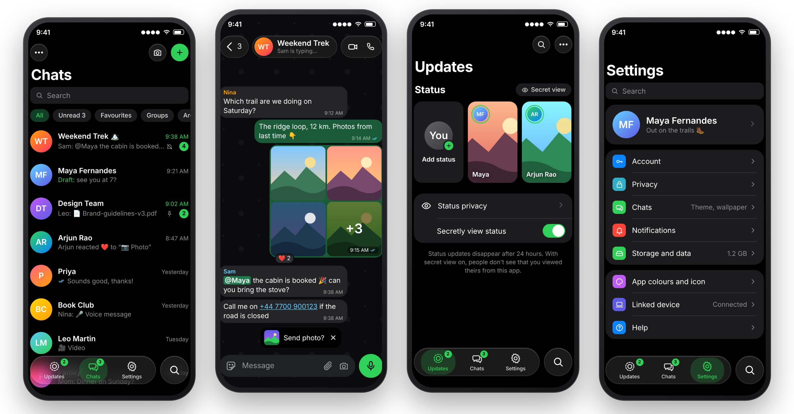
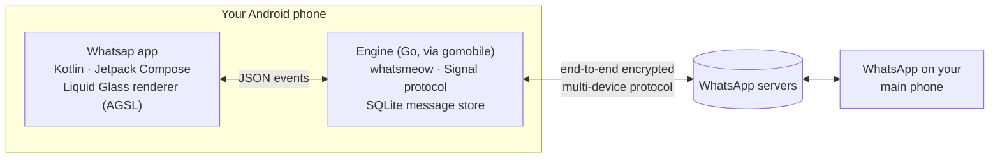

<div align="center">

<picture>
  <source media="(prefers-color-scheme: dark)" srcset="docs/assets/banner-dark.png">
  
</picture>

<br><br>


# Whatsap

**A WhatsApp client for Android, dressed in iOS 26 Liquid Glass.**<br>
Native Kotlin and Jetpack Compose on top of a Go engine. It links to your
account as a companion device, the same way WhatsApp Web does.


[](https://github.com/ayrus404error-commits/whatsap/actions/workflows/build.yml)

[**Download the APK**](https://github.com/ayrus404error-commits/whatsap/releases/latest) ·
[Features](#features) · [Install](#install) · [Build from source](#build-from-source) · [FAQ](#faq)

</div>

<div align="center">
  
  <br>
  <sub>Design mockups with sample data (names and photos are made up).</sub>
</div>

## Why

WhatsApp on Android looks like Android. Whatsap gives you the iPhone
WhatsApp layout and Apple's 2025 "Liquid Glass" material on any Android 10+
phone. Its frosted, light-bending headers, tab bar and menus are rendered
live with an AGSL shader. It also adds a few extras: secret status viewing,
keeping deleted messages, scheduled messages and per-app theming.

## Features

<table>
<tr><td valign="top" width="50%">

**Chats**
- Link with a QR code or an 8-character phone code
- Full history sync from your phone
- Pin, mute, archive, mark unread, lock chats
- Filters: All, Unread, Favourites, Groups, Archived
- Drafts kept per chat ("Draft: …" in the list)
- Global search across chats, photos, videos and links
- New group, add to contacts, open a chat in WhatsApp

**Messages**
- Reply (swipe), forward, edit, delete for everyone, star, pin
- Reactions, with "X reacted 👍 to …" in the chat list
- @mentions, with your own mention highlighted
- Polls, contacts, locations, link previews
- Phone numbers in messages: call, chat, add, copy
- Scheduled messages
- Disappearing messages and "keep deleted messages"

</td><td valign="top" width="50%">

**Media**
- Photos, videos, GIFs, stickers, documents, voice notes with waveform
- Round instant-video notes
- Albums shown as WhatsApp-style grids
- Send as album, without grouping, or as files (full quality)
- In-app camera with multi-select from recents
- Photo editor (crop, draw, blur), video trimming
- View-once send and receive
- "Send photo?" for a screenshot you just took

**Status**
- View, post (text, photo, video) and delete
- Status privacy (contacts, except…, only share with…)
- Secret view: watch without sending a "seen"

**Look and feel**
- Live Liquid Glass headers, tab bar, menus and sheets
- Bubble colours, app colour, page background, wallpapers
- Fonts, text size, letter and line spacing
- Alternate app icons, including your own picture
- Haptic tick and click sound on every tap (optional)

</td></tr>
</table>

**Notifications:** grouped per chat with reply from the notification, play
voice notes without opening the app, direct-share targets and an always-on
background connection.

### Not supported

- **Voice and video calls.** Whatsap can't place or answer calls.
- **Live location.** WhatsApp doesn't let companion devices share it.
- Payments, Communities and Channels.
- Some statuses may arrive late or not at all. WhatsApp doesn't push every status
  to linked devices, so Whatsap asks your phone for them now and then.

## Install

1. Download the latest `Whatsap-*.apk` from [Releases](https://github.com/ayrus404error-commits/whatsap/releases).
2. Open it on your phone and allow installing from your browser or file manager.
3. Open Whatsap. Then, on the phone that has WhatsApp, go to **Settings →
   Linked devices → Link a device** and scan the QR code. You can also choose
   *Link with phone number* in Whatsap and type the code into WhatsApp.
4. Your phone needs to come online every so often (at least once every
   ~14 days), or WhatsApp logs out linked devices.

Requirements: Android 10 or newer on a 64-bit ARM phone (almost every phone since 2019).

## How it works



- **`bridge/`**: the engine, a Go package built on
  [whatsmeow](https://github.com/tulir/whatsmeow). It handles pairing, history
  sync, encryption, media upload and download, and the local SQLite store.
  `gomobile bind` turns it into `wa.aar` for Android.
- **`android/`**: the app (`com.glasschat`), entirely Jetpack Compose.
  `ui/glass/` holds the Liquid Glass renderer: live backdrop capture, blur and
  saturation, then lens refraction with chromatic dispersion and a specular rim.
- Messages stay end-to-end encrypted. Whatsap talks only to WhatsApp, has no
  servers of its own and contains no analytics or tracking. See [PRIVACY.md](PRIVACY.md).

## Build from source

### On GitHub (easiest)

Fork the repo and push. The **Build** workflow compiles the engine and the app
(about 20 minutes), and the APK appears under the run's **Artifacts**. Push a
tag such as `v1.0.0` to publish a Release instead.

To sign with your own key, so that updates install over each other, add these
repository secrets under *Settings → Secrets and variables → Actions*:

| Secret | Value |
|---|---|
| `GLASSCHAT_KEYSTORE_BASE64` | `base64 -w0 my-release.jks` |
| `GLASSCHAT_KEYSTORE_PASSWORD` | keystore password |
| `GLASSCHAT_KEY_ALIAS` | key alias |
| `GLASSCHAT_KEY_PASSWORD` | key password |

Without them the APK is signed with a throwaway debug key. It installs fine,
but an APK signed with a different key can't update it.

Create a key once with:

```bash
keytool -genkeypair -v -keystore my-release.jks -alias glasschat \
  -keyalg RSA -keysize 4096 -validity 10000
```

> [!CAUTION]
> Never commit a keystore. `.gitignore` already excludes `*.jks` and `*.keystore`.

### Locally (Linux)

Needs JDK 17, Gradle 8.14 and network access to GitHub and Google's Maven.

```bash
bash tools/bootstrap.sh   # Go, gomobile, Android SDK and NDK (first run ~6 min)
# run the export lines it prints, then:
export GLASSCHAT_KEYSTORE=/path/to/my-release.jks   # optional, plus the 3 passwords
bash tools/build.sh       # → android/app/build/outputs/apk/release/app-release.apk
```

`bridge/engine_test.go` runs a full offline simulation of the engine (pairing
aside) and runs on every build.

## Project layout

| Path | What's there |
|---|---|
| `bridge/` | Go engine (package `wa`): client, events, store, media, status, search |
| `android/app/src/main/java/com/glasschat/engine/` | Kotlin side of the engine: state flows, models |
| `android/app/src/main/java/com/glasschat/ui/` | Screens, components, theme, Liquid Glass |
| `android/app/src/main/java/com/glasschat/service/` | Background connection, notifications |
| `android/app/src/main/res/drawable-nodpi/chat_icon_custom.png` | The "Custom" app icon. Replace it with your own picture. |
| `tools/` | Local build scripts |
| `docs/` | Logo, screenshots, [development log](docs/DEVLOG.md) |

## FAQ

**Will my account get banned?**
It can happen. WhatsApp doesn't allow unofficial clients. Many people use
whatsmeow-based apps without trouble, but there's no guarantee. Use a spare
number if losing yours would hurt.

**Does it replace WhatsApp on my phone?**
No. It's a *linked device*, like WhatsApp Web. Your main WhatsApp must stay
installed somewhere, ideally on another phone or as the primary on this one.

**Why doesn't a status show up?**
WhatsApp doesn't send every status to linked devices. *Settings → Devices →
Status check* shows what arrived and lets you ask your phone again.

**Can I use my own app icon?**
Yes. Replace `chat_icon_custom.png` (a square PNG, 432 px or more), build, then
pick **Custom** in *Chat settings → App icon*. Don't use logos you don't own.

## Contributing

Issues and pull requests are welcome. Please read [CONTRIBUTING.md](CONTRIBUTING.md)
first. Report security problems privately as described in [SECURITY.md](SECURITY.md).

## License

Whatsap is free software under the **GNU General Public License v3.0 or later**
([LICENSE](LICENSE)). The engine links
[libsignal (Go)](https://github.com/tulir/libsignal) (GPL-3.0) and
[whatsmeow](https://github.com/tulir/whatsmeow) (MPL-2.0), so the app as a whole
is distributed under the GPL. Third-party licences are listed in
[THIRD_PARTY_NOTICES.md](THIRD_PARTY_NOTICES.md).

## Acknowledgements

- [whatsmeow](https://github.com/tulir/whatsmeow) and [libsignal](https://github.com/tulir/libsignal) by Tulir Asokan and contributors. None of this would exist without them.
- [Jetpack Compose](https://developer.android.com/compose), [gomobile](https://pkg.go.dev/golang.org/x/mobile) and the Go team.

## Trademarks

WhatsApp is a trademark of WhatsApp LLC; iOS and Liquid Glass are trademarks of
Apple Inc. Whatsap is an independent project and is not affiliated with either.
